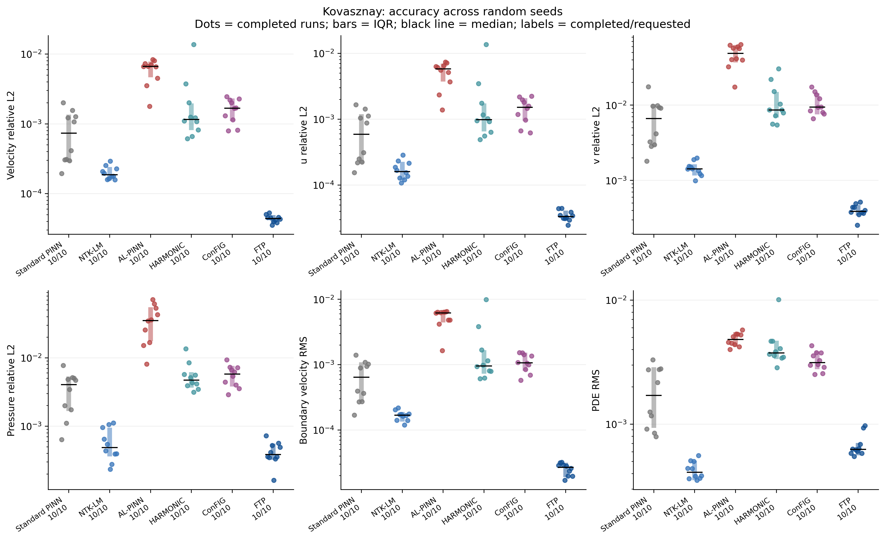
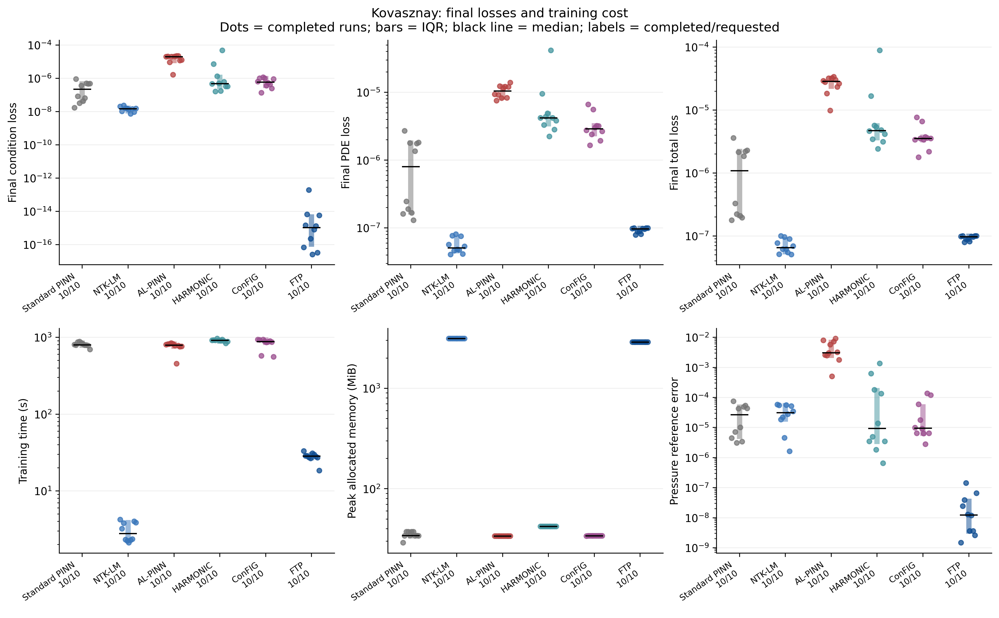
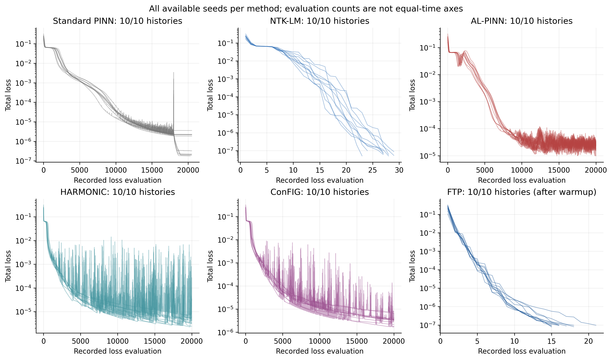
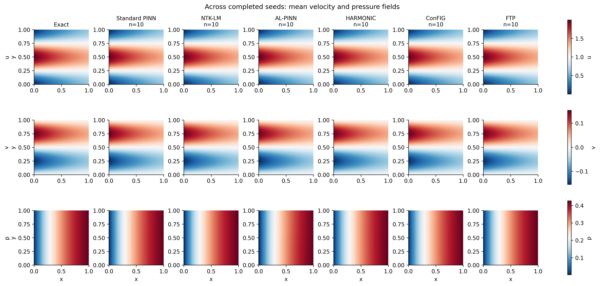
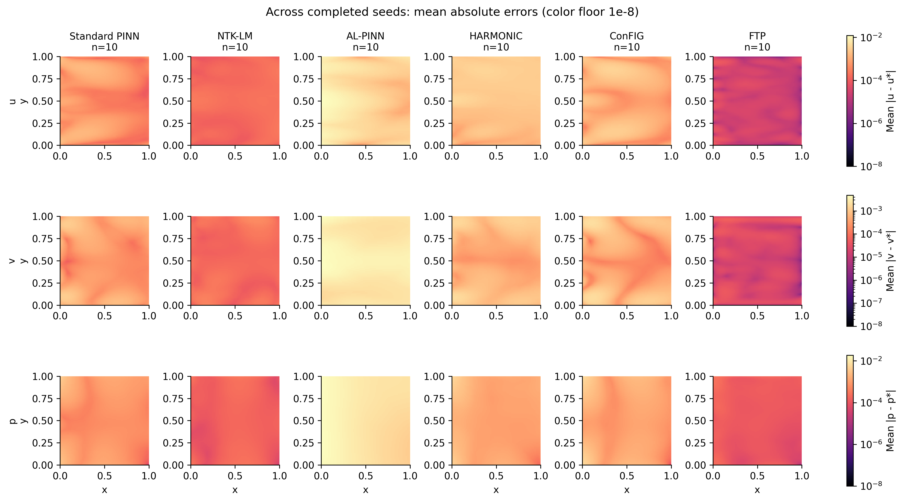

# 二维 Navier–Stokes：随机种子综合对比

参照三维 Helmholtz 的统计和展示方式，求解与误差图改为 u、v、p 的跨种子汇总。

计划种子：0, 1, 2, 3, 4, 5, 6, 7, 8, 9，每种方法 10 次运行。
独立解场网格 81×81；每边 81 个中心点；PDE 网格 33×33。

## 完成情况、独立精度与尾部误差

| 方法 | 完成/计划 | 失败 | 缺失/未完成 | 损失达标 | 速度精度达标 | 速度 L2 中位数 | 速度 L2 P90 | 时间中位数/s |
|---|---:|---:|---:|---:|---:|---:|---:|---:|
| Standard PINN | 10/10 | 0 | 0 | 0 | 0 | 0.0007376 | 0.001602 | 798.5 |
| NTK-LM | 10/10 | 0 | 0 | 10 | 0 | 0.000186 | 0.0002563 | 2.784 |
| AL-PINN | 10/10 | 0 | 0 | 0 | 0 | 0.006629 | 0.008021 | 793 |
| HARMONIC | 10/10 | 0 | 0 | 0 | 0 | 0.001158 | 0.004732 | 913 |
| ConFIG | 10/10 | 0 | 0 | 0 | 0 | 0.001673 | 0.002292 | 879.4 |
| FTP | 10/10 | 0 | 0 | 10 | 10 | 4.388e-05 | 5.042e-05 | 28.3 |

参照三维判据，将独立速度精度达标定义为：速度向量相对 L2 ≤ 0.001 且边界速度 RMS ≤ 0.0001；这不是压力精度的达标判据。损失达标依据保存模型重新计算的训练损失。

## 各方法已完成结果：均值 ± 样本标准差

统计仅覆盖完成并通过模型重载检查的运行。失败和缺失保留在计划数及达标率分母中，不为其填入零误差或虚构耗时。

| 方法 | 样本数 | 速度相对 L2 | 压力相对 L2 | 边界速度 RMS | PDE RMS | 总耗时/s |
|---|---:|---:|---:|---:|---:|---:|
| Standard PINN | 10 | 8.618e-04 ± 6.412e-04 | 3.626e-03 ± 2.238e-03 | 6.791e-04 ± 4.318e-04 | 1.873e-03 ± 9.738e-04 | 8.053e+02 ± 5.187e+01 |
| NTK-LM | 10 | 2.005e-04 ± 4.439e-05 | 6.045e-04 ± 3.264e-04 | 1.667e-04 ± 2.945e-05 | 4.287e-04 ± 7.219e-05 | 3.045e+00 ± 8.667e-01 |
| AL-PINN | 10 | 6.016e-03 ± 2.089e-03 | 3.637e-02 ± 2.077e-02 | 5.338e-03 ± 1.548e-03 | 4.831e-03 ± 5.771e-04 | 7.626e+02 ± 1.117e+02 |
| HARMONIC | 10 | 2.614e-03 ± 3.995e-03 | 5.749e-03 ± 3.140e-03 | 2.120e-03 ± 2.875e-03 | 4.426e-03 ± 2.059e-03 | 9.071e+02 ± 3.387e+01 |
| ConFIG | 10 | 1.631e-03 ± 6.025e-04 | 5.678e-03 ± 2.003e-03 | 1.105e-03 ± 3.406e-04 | 3.257e-03 ± 5.769e-04 | 8.311e+02 ± 1.432e+02 |
| FTP | 10 | 4.359e-05 ± 5.298e-06 | 4.260e-04 ± 1.542e-04 | 2.545e-05 ± 5.315e-06 | 6.790e-04 ± 1.486e-04 | 2.782e+01 ± 3.864e+00 |

## 相同种子集合上的综合对比

共同完成集合：0, 1, 2, 3, 4, 5, 6, 7, 8, 9。下表所有方法使用相同种子集合；上表仍报告各方法全部完成结果及失败数。

| 方法 | 样本数 | 速度相对 L2 | 压力相对 L2 | 边界速度 RMS | PDE RMS | 总耗时/s |
|---|---:|---:|---:|---:|---:|---:|
| Standard PINN | 10 | 8.618e-04 ± 6.412e-04 | 3.626e-03 ± 2.238e-03 | 6.791e-04 ± 4.318e-04 | 1.873e-03 ± 9.738e-04 | 8.053e+02 ± 5.187e+01 |
| NTK-LM | 10 | 2.005e-04 ± 4.439e-05 | 6.045e-04 ± 3.264e-04 | 1.667e-04 ± 2.945e-05 | 4.287e-04 ± 7.219e-05 | 3.045e+00 ± 8.667e-01 |
| AL-PINN | 10 | 6.016e-03 ± 2.089e-03 | 3.637e-02 ± 2.077e-02 | 5.338e-03 ± 1.548e-03 | 4.831e-03 ± 5.771e-04 | 7.626e+02 ± 1.117e+02 |
| HARMONIC | 10 | 2.614e-03 ± 3.995e-03 | 5.749e-03 ± 3.140e-03 | 2.120e-03 ± 2.875e-03 | 4.426e-03 ± 2.059e-03 | 9.071e+02 ± 3.387e+01 |
| ConFIG | 10 | 1.631e-03 ± 6.025e-04 | 5.678e-03 ± 2.003e-03 | 1.105e-03 ± 3.406e-04 | 3.257e-03 ± 5.769e-04 | 8.311e+02 ± 1.432e+02 |
| FTP | 10 | 4.359e-05 ± 5.298e-06 | 4.260e-04 ± 1.542e-04 | 2.545e-05 ± 5.315e-06 | 6.790e-04 ± 1.486e-04 | 2.782e+01 ± 3.864e+00 |

## FTP 优势判据

参照三维脚本：正式种子 0–9 全部完成，FTP 的速度相对 L2 中位数和 P90 均低于最佳完整基线，且至少 8/10 次配对获胜。该判据只针对速度相对 L2。
以完整种子集速度相对 L2 中位数最低的方法 NTK-LM 为基线。已有共同完成运行中，FTP 获胜 10/10。
在已有配对集合上，FTP/基线的中位数为 4.388e-05/0.000186，P90 为 5.042e-05/0.0002563。
正式优势判据达到。

## 综合图

## 图表与统计口径

- 分布图：散点为每次完成运行，粗线为 25%–75% 分位区间，黑线为中位数。零值只在对数图中显示为 1e-20，表格保持原值。
- 解场按各方法完成种子求平均，图头标注样本数。误差图先对每个种子取绝对误差再求平均，避免正负误差在平均解中抵消；各方法同一分量共用色标。图中误差下限为 1e-8，NPZ 不截断。
- mean_fields.npz 保存解析解、各方法平均解、平均绝对误差、跨种子总体标准差和样本数；该标准差不是均值置信区间。
- 训练历史每个方法一个面板，叠加请求种子中所有可用历史，不生成单个种子的图。如失败运行保留了历史，也会显示；缺失数量另存 loss_record_counts.csv。
- 训练曲线横轴为原始损失记录序号，L-BFGS 包含线搜索评价，各方法不能按横轴解读为等迭代成本或等时间。FTP 曲线从条件预训练之后开始。
- 时间包含 FTP 预训练和主体训练，取原运行记录，排除独立评估和文件保存；各方法仍使用原学习率和训练协议，不属于等时间或等预训练预算消融。
- metrics_summary.csv 和 common_seeds_summary.csv 含样本数、均值、样本标准差、中位数、Q25、Q75、P90、最小值和最大值；run_status_summary.csv 含完成、失败与达标率。
- metrics_by_seed.csv 仅作为底层复核数据，报告和图按方法综合呈现。ftp_advantage.json 保存汇总判据，evaluation_config.json 保存本次评估设置。
- 图形同时提供 PNG、PDF、SVG。
